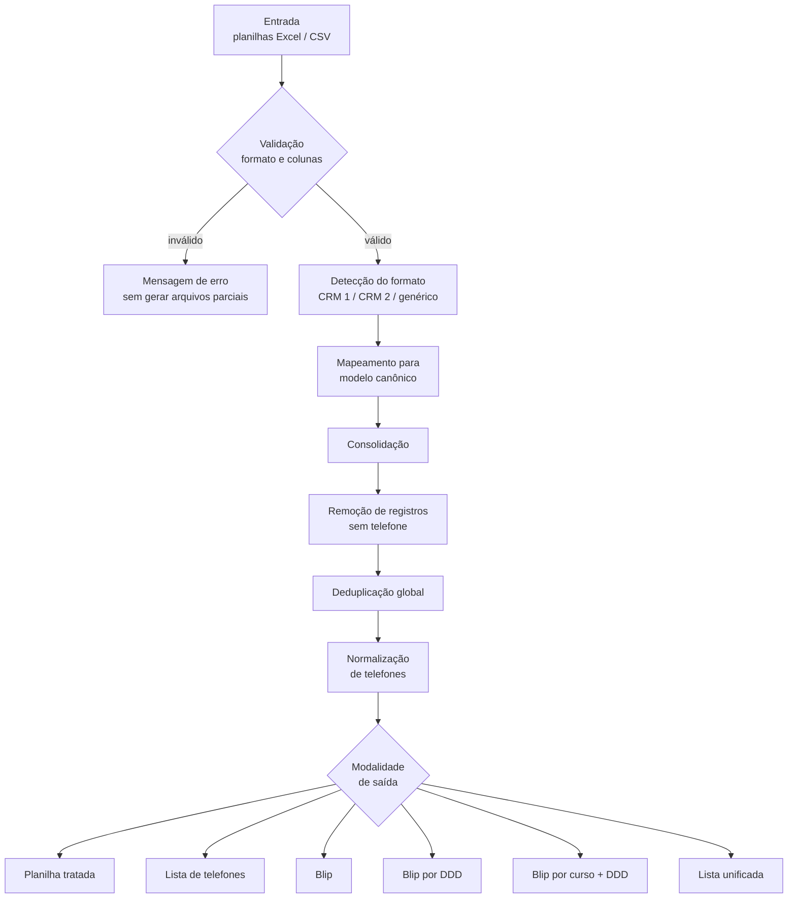

# Conversor de Planilhas para CRM

> Aplicação desktop em Python que automatiza o tratamento de planilhas de CRM: lê diferentes formatos, limpa e normaliza os dados de contato e os entrega prontos para uso comercial — sem exigir que o usuário saiba programar.


Transformei uma rotina manual de tratamento de planilhas de CRM em uma aplicação de dados testada, que lê diferentes formatos, limpa e normaliza os contatos e os entrega prontos para campanhas.

---

## Demonstração

O vídeo mostra o fluxo completo na interface: seleção das planilhas, escolha do formato de saída e processamento, com as métricas do resultado exibidas ao final. A aplicação foi pensada para uso por pessoas não técnicas, sem contato com código.

**▶️ [Assistir à demonstração da aplicação](https://drive.google.com/file/d/1U8GxvEW_rDgxBIpWsX5eXQBhO54hYpFu/view?usp=sharing)**

<!--
Existe também um GIF local de demonstração em `test/Teste-UX.gif` (~8 MB).
Se quiser usá-lo como preview inline no README, mova-o para `assets/` e
descomente a linha abaixo. Por ora o link do Drive é a demonstração oficial,
para não versionar um binário grande no repositório.


-->

---

## Problema

As listas de contatos exportadas do CRM chegavam em condições muito diferentes entre si, e prepará-las para campanhas era um trabalho manual e repetitivo:

- planilhas em **formatos distintos** (mais de um layout de CRM e planilhas genéricas);
- colunas que precisavam ser **limpas e padronizadas** antes de qualquer uso;
- **registros sem telefone**, que não servem para contato e precisavam ser descartados;
- **linhas duplicadas**, dentro de um mesmo arquivo e entre arquivos diferentes;
- **telefones em padrões variados** (com e sem DDD, com e sem código do país, com máscara);
- necessidade de **segmentar os contatos por DDD** (três números de WhatsApp operacionais) e **por curso**;
- regras específicas de importação do **Blip**, que exige CSVs com no máximo 100 contatos e 100 KB por arquivo;
- todo o processo dependia de **tratamento manual**, planilha a planilha, sujeito a erro e difícil de repetir da mesma forma.

---

## Solução

A aplicação centraliza esse fluxo em uma **interface desktop** voltada também para usuários não técnicos. O usuário seleciona as planilhas, escolhe o formato de saída e recebe os arquivos tratados, com métricas de quantos registros foram lidos, descartados sem telefone, deduplicados e entregues no resultado. O processamento roda em segundo plano para manter a interface responsiva.

O mesmo conjunto de regras passa a ser aplicado sempre da mesma forma, de ponta a ponta:

```text
Planilhas → validação → identificação do formato → padronização →
consolidação → deduplicação → normalização → segmentação → arquivos de saída
```

---

## Funcionalidades principais

**Leitura e identificação**
- Leitura de diferentes formatos de planilha (Excel e CSV, conforme a modalidade).
- Identificação do formato pelos **cabeçalhos** das colunas, não pelo conteúdo das células.
- Suporte a diferentes layouts de CRM e a planilhas genéricas.
- Leitura apenas das abas **visíveis** (ignora abas `hidden` e `veryHidden`).

**Tratamento de dados**
- Remoção de registros sem telefone.
- Deduplicação (integral na V1; global entre arquivos a partir da V2).
- Normalização de telefones brasileiros (remove máscara, prefixa o código do país quando aplicável).

**Segmentação**
- Classificação por DDD em grupos operacionais (47, 49, 48 e outros, e sem DDD identificável).
- Segmentação por curso, com tabela de equivalências cadastrada manualmente.

**Exportação**
- Geração de planilha completa tratada e de lista de telefones.
- Geração de listas para o **Blip**, respeitando o limite de **100 contatos e 100 KB** por arquivo (CSV UTF-8 sem BOM).
- Geração de um **arquivo de revisão** (Excel) para conferência manual antes dos CSVs finais.
- Unificação de múltiplas listas em uma única lista de telefones deduplicada.
- Suporte a diferentes codificações de CSV na leitura.
- **Relatório de inválidos**: registros não classificáveis são reportados, nunca descartados em silêncio.

**Usabilidade**
- Interface gráfica (CustomTkinter) para usuários não técnicos.
- Tutorial integrado, exibido no primeiro acesso e reabrível a qualquer momento.
- Validação prévia que interrompe o processamento sem gerar arquivos parciais quando uma planilha não atende aos requisitos.

---

## Arquitetura

O projeto separa interface, adaptação de formatos e regras de negócio em módulos independentes. A entrada passa por validação, padronização, normalização e segmentação antes da exportação. O diagrama abaixo representa a arquitetura atual:



---

## Evolução do projeto

O produto evoluiu de forma incremental. Cada versão acrescentou capacidades sem quebrar as anteriores — as regras e saídas antigas permanecem como referência de regressão.

| Versão | O que trouxe |
|---|---|
| **V1** | Tratamento básico de planilhas: remoção de registros sem telefone, deduplicação, normalização de telefone e geração dos arquivos iniciais (planilha completa e lista de telefones). |
| **V2** | Múltiplos arquivos por execução, novos formatos de CRM e planilhas genéricas, **modelo canônico** interno, consolidação e **deduplicação global** entre arquivos, e novos formatos de saída. |
| **V3** | Integração do fluxo de geração de contatos para o **Blip**: limite de 100 contatos / 100 KB por arquivo, arquivo de revisão intermediário e CSV final a partir da planilha revisada. |
| **V3.1** | Classificação por **DDD**, grupos de DDD, organização das saídas por DDD e reimportação com reclassificação pelo telefone atual. |
| **V3.2** | Segmentação por **curso + DDD**, tabela de equivalência de cursos e organização das saídas por curso e DDD. |
| **V3.3** | **Unificação** de múltiplas listas, exportação em CSV/Excel, suporte a múltiplas codificações, relatório de inválidos e **tutorial** integrado. |

---

## Tecnologias

- **Python** — linguagem principal.
- **pandas** — leitura, limpeza e transformação dos dados.
- **openpyxl** — leitura e escrita de planilhas Excel.
- **CustomTkinter** (sobre o `tkinter`) — interface gráfica desktop.
- **Pillow** — tratamento de imagens da interface.
- **PyInstaller** — empacotamento para executável Windows, configurado em `Conversor_CRM.spec`. É uma ferramenta de build opcional; não faz parte das dependências de execução em `requirements.txt`, e o executável ainda não foi gerado.

---

## Qualidade e testes

O projeto tem **238 testes automatizados (`unittest`), todos passando**. A suíte funciona como rede de regressão: mudanças que quebrem as regras de deduplicação, normalização de telefone, classificação por DDD ou os limites de exportação do Blip falham nos testes.

Distribuição por suíte:

| Suíte | Testes | Área coberta |
|---|---:|---|
| `test_adapters.py` | 42 | Detecção de formato e mapeamento para o modelo canônico |
| `test_blip_ddd.py` | 39 | Classificação por DDD e estrutura das saídas |
| `test_blip.py` | 37 | Requisitos do CSV do Blip (colunas, 100 contatos, 100 KB, UTF-8) |
| `test_blip_curso_ddd.py` | 34 | Segmentação por curso + DDD e reimportação |
| `test_unificar.py` | 24 | Unificação de listas, codificações e relatório de inválidos |
| `test_consolidacao.py` | 15 | Consolidação e deduplicação global |
| `test_cursos.py` | 15 | Padronização de curso e nomes de pasta |
| `test_app_feedback.py` | 15 | Mensagens e feedback da interface |
| `test_tutorial.py` | 14 | Navegação e persistência à prova de falhas das preferências |
| `test_processamento.py` | 3 | Regressão das saídas e métricas da V1 |

Além da suíte funcional, há um **teste de desempenho** separado (`test/test_desempenho.py`), que mede o tempo de processamento com dados sintéticos (5 mil, 10 mil e 25 mil registros). Os tempos são referência de desenvolvimento, não garantia universal.

Execução:

```bash
python -m unittest -v
python test/test_desempenho.py
```

---

## Estrutura do projeto

```text
Conversor_Planilha/
├── app.py              # Interface desktop (CustomTkinter): seleção, feedback e métricas
├── processamento.py    # Núcleo V1: leitura de abas visíveis, dedup e normalização de telefone
├── adapters.py         # Detecção de formato e mapeamento para o modelo canônico
├── pipeline_v2.py      # Consolidação de múltiplos arquivos e deduplicação global
├── blip.py             # Exportação para o Blip e classificação por DDD
├── cursos.py           # Padronização de curso e nomes de pasta seguros
├── unificar.py         # Unificação de múltiplas listas de telefones
├── tutorial.py         # Tutorial integrado e persistência de preferências
├── test_*.py           # Suíte de testes automatizados (238 testes)
├── test/               # Teste de desempenho e material de demonstração
├── assets/             # Recursos visuais da interface
├── requirements.txt    # Dependências de execução
└── Conversor_CRM.spec  # Configuração de empacotamento (PyInstaller)
```

Papel dos principais módulos:

- **`app.py`** — a interface gráfica e a orquestração do fluxo para o usuário.
- **`processamento.py`** — as regras centrais de tratamento, herdadas da V1 e reutilizadas pelas versões seguintes.
- **`adapters.py`** — concentra as diferenças entre formatos de origem, convertendo cada planilha para um modelo interno comum.
- **`pipeline_v2.py`** — junta vários arquivos em um único conjunto e aplica a deduplicação global.
- **`blip.py`** — prepara os contatos para o Blip e os classifica por DDD.
- **`cursos.py`** e **`unificar.py`** — segmentação por curso e unificação de listas.

---

## Como executar

Requer **Python 3.x**.

```bash
# 1. Clonar o repositório
git clone https://github.com/MDCarvalho-77/Conversor_Planilha.git
cd Conversor_Planilha

# 2. Criar e ativar um ambiente virtual
python -m venv .venv
# Windows (PowerShell):
.\.venv\Scripts\Activate.ps1
# Linux/macOS:
source .venv/bin/activate

# 3. Instalar as dependências
pip install -r requirements.txt

# 4. Executar a aplicação
python app.py

# 5. Executar os testes
python -m unittest -v
```

No Windows, se a política do PowerShell impedir a ativação do ambiente, execute o interpretador do ambiente virtual diretamente:

```powershell
.\.venv\Scripts\python.exe app.py
```

---

## Segurança e dados

O repositório público **não contém dados reais de CRM**. O `.gitignore` bloqueia exports reais e as planilhas de saída geradas pelo processamento; apenas planilhas de teste controladas são mantidas. Os testes usam dados sintéticos criados em arquivos temporários durante a execução.

---

## Status

Projeto **funcional**, em evolução incremental. Versão atual: **V3.3**, com todas as versões concluídas e 238 testes passando. O empacotamento Windows está configurado em `Conversor_CRM.spec`; o executável ainda não foi gerado.

---

## Autor

**Maykon Carvalho** — em transição de carreira da área comercial/operacional para tecnologia, com foco em automação de processos, tratamento de dados e desenvolvimento em Python.

Este projeto nasceu de uma necessidade operacional real e evoluiu para uma aplicação Python testada, com foco em tratamento e preparação de dados e em usabilidade para pessoas não técnicas.

- GitHub: [MDCarvalho-77](https://github.com/MDCarvalho-77)
- LinkedIn: [Maykon Douglas da Silva Carvalho](https://www.linkedin.com/in/maykon-douglas-da-silva-carvalho-2aa271239)
